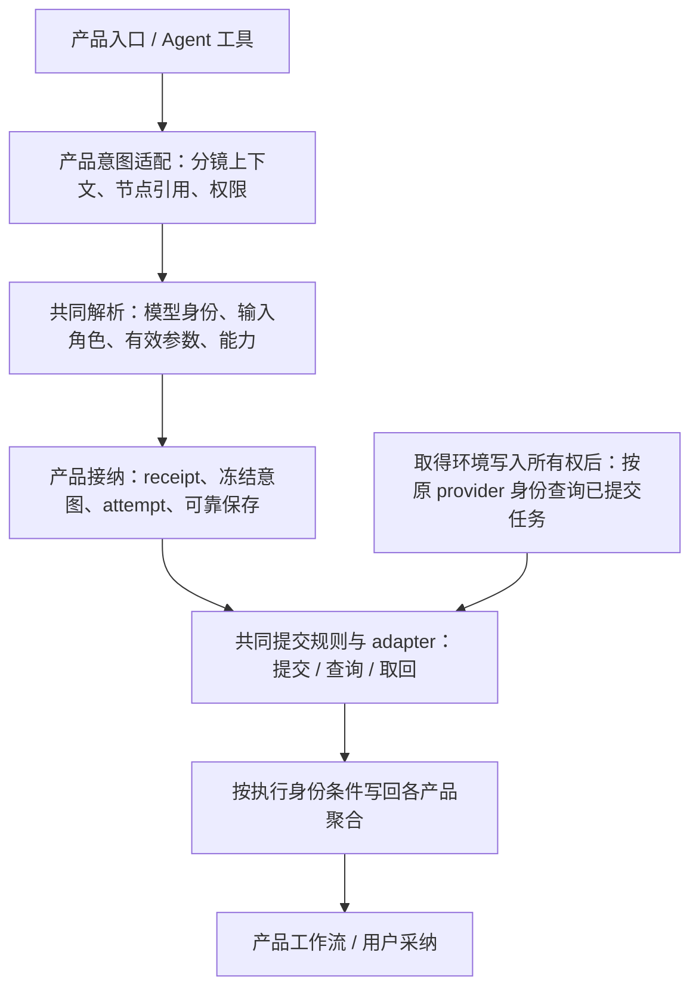

# LumenX 架构设计收束

架构视图核对：2026-10-09。历史文件名保留兼容，本文是已收束的目标责任视图，不是待投票草稿。决定由 ADR 维护，实施协议和顺序只见 [计划](REFACTOR-PLAN.md#execution-order)，实际进度只见 [台账](EXECUTION-STATUS.md)；材料关系见 [README](README.md)。本文不作为源码已重构或测试通过的证据。

## 先承认现有架构，再明确缺口

2026-10-08 的 Core 可行性审查曾核查当时 main、Studio Wan 固定提交和 Atelier 工作区；原报告保留在研发来源快照，公开议题见 [历史发现摘要](HISTORICAL-FINDINGS.md)。以下介绍目标形成时的背景，不是当前源码缺口清单。现有路线图的独立产品域、共享能力方向已经落实了一部分：目录/adapter 复用，Atelier 画布/Agent 进入同一候选服务。上一版泛化的“模块化单体 + 统一 Core”不足以说明实际要改什么。

当前需要区分：

1. 已共享且应保留的目录、能力工具、供应商调用实现及候选服务。
2. 可以在现有接缝上收敛的字段映射、校验、默认值、派发结果和供应商诊断。
3. 尚未统一的任务身份、状态写回、调度与保存保障；它们需要独立设计，不能隐含在一次接口抽取中。

已确认的使用约束保持不变：本机独立运行、可选 ECS、浏览器/桌面均可操作、每个项目有一处正式状态、项目携带采用独立复制、多人协作先考虑边界而暂不实现。部署操作与复制交互细节留到试用阶段。

## 已确认的共享边界（Q6）

用户明确提交的生成意图，不应因为从某个入口进入而被悄悄丢弃或改义。入口可以提供不同的能力子集，但应明确声明、校验和反馈。不同产品的创作对象、批量策略和结果采纳仍由各自产品拥有。

用户已选择由 Core 统一参数含义、能力校验与供应商执行契约；Studio、Atelier、Agent 无须同步开放每项模型能力。这里的功能入口，与浏览器/桌面操作入口是两个维度。决定与取舍见 [ADR-0003](adr/0003-shared-core-contracts-with-explicit-entry-capabilities.md)，共用执行协议而不先建通用任务仓库见 ADR-0006。

“共享规则”不要求所有 URL、返回对象、前端状态和产品流程相同；“同一份目录”也不能代替从 UI 到实际供应商请求的完整契约验证。

## 已确认的默认值责任（Q7）

Core 按共同规则解析有效生成参数，模型目录提供基础默认，用户明确设置的值优先保留。产品需要不同的默认组合时，通过明确、可见的生成预设表达，不让前端、API 与执行层各自隐式回退。界面、请求与实际执行需要验证一致性。

决定来源为 [ADR-0004](adr/0004-core-resolves-generation-defaults.md)。优先级、显式值/省略、项目设置投影与校验按计划第 4–5 节的单一实施协议落实；此处不另维护一份解析算法。

## 已确认的参数时间边界（Q8）

任务接纳时保存补齐后的完整有效参数；失败重试使用原参数，不重新按当前目录/预设补齐。修改参数或采用新默认属于新的生成，保留原记录和来源关系。当前能力与权限校验仍需执行，参数固定不承诺生成内容完全相同。

固定媒体、历史快照兼容和批准绑定的决定仍由 ADR-0004 维护；接纳/提交/查询的操作顺序见计划第 5 节，反例见 CJ-01–04。参数快照不足与查询身份不足必须分别处理。

## 已确认的查询恢复（Q9）

对已经提交或不能排除已提交的任务，按 [ADR-0005](adr/0005-recover-submitted-work-without-resubmission.md) 查询原任务；查询身份不足/无法确认时保持待确认，不自动重新生成。持久证据证明尚未提交的排队任务续跑是另一种分支，必须通过原授权、未取消及执行所有权检查；三分支详见 CJ-04 与计划第 5 节。

## 目标调用边界与责任顺序

这是责任顺序，不要求模块按图逐框命名，也不凭图判断实现完成。当前源码入口见测试矩阵，实际结果见台账。图中“已提交任务查询”的箭头只使用 query/fetch，不触发 submit；它不涵盖有持久证明的排队任务续跑。批准绑定、receipt/attempt/owner、状态守卫与付费门禁统一按计划第 5 节实现；公共层不建立第二套任务事实源。

| 边界 | 可以统一的内容 | 应保留的产品责任 |
|---|---|---|
| 输入 | 模型 ID、明确的首尾帧/参考角色、显式值与缺省、能力校验 | 分镜预览图含义、prompt token 解析、产品能力子集与 batch 策略 |
| 接纳 | 错误分类、可供派发的明确接纳结果 | 项目/节点归属、批准范围、产品任务/候选与持久化 |
| 供应商执行 | adapter 选择、参数转换、媒体结果、provider ID 诊断 | 何时允许提交、产物位置、重试决定 |
| 完成写回 | 已确定共用的执行身份守卫、状态转移和失败语义 | Studio 分镜/资产关联、Atelier review/选择、Playground 部分成功 |
| 保存 | 成功才确认、失败可观察、保留可恢复内容 | 产品聚合模型；不强制共用一个通用 JSON 对象 |
| 前端 | 中性客户端契约、能力声明与可验证映射 | Studio/Atelier 独立状态、交互和创作流程 |

实施顺序只采用 [计划依赖段](REFACTOR-PLAN.md#execution-order)：公共输入/预览的 P3 与 F37 先于 Atelier 派发 P4；主线基础可先行。目录迁移随依赖收敛，不再从本架构摘要推导另一条执行顺序。

## 按授权直接作出的其余工程选择

- 采用模块化单体和渐进共用执行协议，保留产品任务/采纳状态；不先引入微服务、分布式队列或整体数据库迁移。真实替代方案和代价见重构计划。
- 当前一个数据目录只允许一个写进程；原子保存、失败回滚、损坏保护逐个扩展到实际聚合。跨文件命令单独定义一致性和恢复，不能将一次 rename 当作完整事务。
- 编辑命令只提交自己拥有的字段，并检查版本冲突。移动节点不覆盖引用或生成参数；同一用户多窗口也适用，不等多人功能才处理。
- 快照冻结媒体版本/内容身份，提交使用固定版本的传输地址；重签只改变访问凭据。旧媒体消失或无法固定内容时明确失败，不能换最新文件再付费。
- 本地默认 loopback，远程有访问控制；媒体路由不能暴露内部 JSON/配置；桌面核验服务身份、协议版本及进程所有权，缓存按环境隔离。本轮正式桌面沿现行 `main.py → PyInstaller` 构建验收，Tauri 保留实验入口，不以其开发运行替代正式包结果。
- 先补生产行为回归再修改代码。镜像实现、未收集测试、只测 helper 不代表前后端功能得到完整保护；Q6–Q9 改变的旧行为另列迁移清单。

这些是本次授权范围内的工程决定，不反写成用户逐题确认；渐进收敛的真实取舍见 [ADR-0006](adr/0006-converge-execution-with-product-owned-state.md)。仍由调查解决的事实包括：各 provider 查询/取消/幂等/音频的官方约束；实际跨文件写命令；入口能力详细清单；各测试的收集与执行结果；Qoder 增强形成可纳入固定提交的时点。它们不是让用户猜测接口行为的问题。

现有 Atelier 服务仍依赖自己的项目/节点存储，不应直接改名为 Core 服务并交给 Studio 使用；反过来，也不能用 Studio 的简单任务状态覆盖 Atelier 已实现的幂等、取消和审批保障。

## 测试与进入实施的依据

先在导入应用前隔离测试目录、配置、网络和预热。2026-10-09 旧基线中部分 fixture 曾先构造 pipeline 再改路径；当前必须使用仓库收集前隔离运行器，不能恢复旧的不安全运行方式。

后续每项改动应有明确的行为验证：同一受支持意图不丢参数；不支持的输入明确失败；缺省/0/false/-1 语义稳定；所有 Agent 路由正确派发；重放不重复付费；旧尝试不覆盖新尝试；保存失败不确认成功；公共结果仍按各产品规则归属与采纳。

已形成 44 个功能组的测试映射初版，区分真实单元/集成/API/组件、测试内镜像、未被默认收集和缺少端到端证据；尚需在实施基线落实到每项操作/状态及运行结果。2026-10-09 盘点没有产品测试或构建结果；后续结果只查执行台账。重构计划按用户已有授权具体化，不再逐项询问明显工程选择；只有改变产品承诺、自动付费权限、协作/同步范围或不可逆数据行为时才重新讨论。
